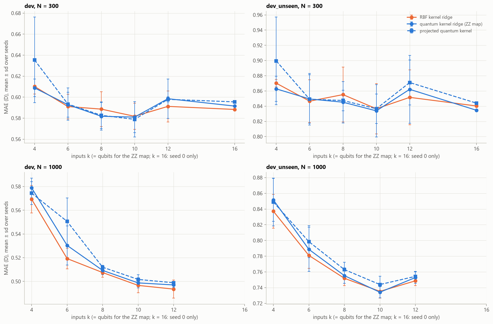
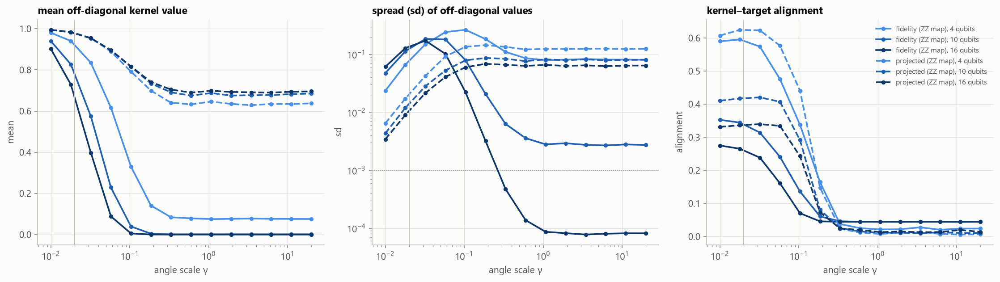
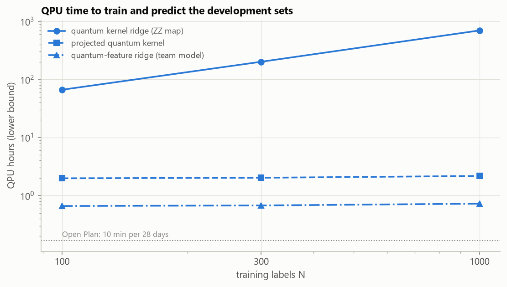
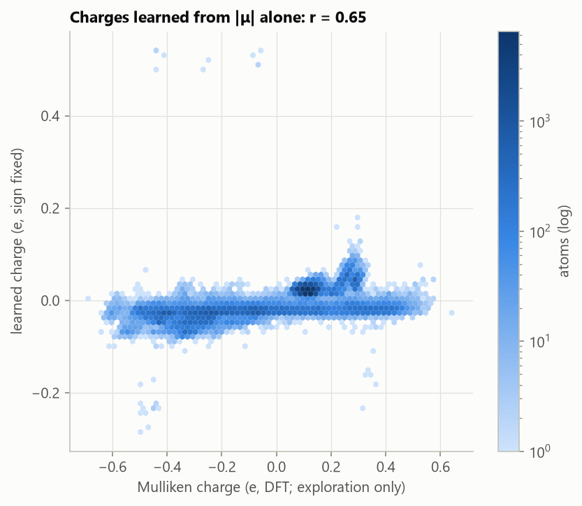

# Results

Every result of the project, with the figures behind it. Numbers are **mean absolute error (MAE) in debye (D)**,
mean ± standard deviation over 3 training seeds, on the test sets unless marked "development". For scale: a typical
molecule has |μ| ≈ 2.5 D, and always predicting the training mean gives MAE ≈ 1.14 D (familiar formulas) and
1.25 D (unseen formulas). How each number was produced is in [methods.md](methods.md); the notebooks that produced
them are linked in each section.

**Contents**

1. [Quantum models vs their classical twin](#1-quantum-models-vs-their-classical-twin)
2. [How far classical models go](#2-how-far-classical-models-go)
3. [Why the quantum kernels tie](#3-why-the-quantum-kernels-tie)
4. [Familiar vs unseen formulas, and composition vs geometry](#4-familiar-vs-unseen-formulas-and-composition-vs-geometry)
5. [Finite shots and shot-aware tuning](#5-finite-shots-and-shot-aware-tuning)
6. [Noise and IBM hardware](#6-noise-and-ibm-hardware)
7. [What it would cost on hardware](#7-what-it-would-cost-on-hardware)
8. [What the classical models learned](#8-what-the-classical-models-learned)
9. [Limitations](#9-limitations)
10. [Lessons learned](#10-lessons-learned)
11. [Next steps](#11-next-steps)

---

## 1. Quantum models vs their classical twin

Source: [notebook 10](../notebooks/10_test_set_results.ipynb), evaluation run 1;
[`results/comparison/test_run01_quantum.csv`](../results/comparison/test_run01_quantum.csv). All models below use the
same 10 inputs (10 PLS components = 10 qubits for the ZZ map), the same training sets, folds and tuning budget,
except the two "all 188 features" rows.

| Model | N = 100 | N = 300 | N = 1,000 | N = 1,000, unseen formulas |
|---|---|---|---|---|
| **QKRR, ZZ map (headline quantum model)** | 0.735 ± 0.062 | 0.578 ± 0.011 | **0.492 ± 0.008** | **0.437 ± 0.010** |
| QKRR, RY + CZ | 0.739 ± 0.068 | 0.585 ± 0.012 | 0.493 ± 0.009 | 0.433 ± 0.007 |
| QKRR, RY-RZ (5 qubits) | 0.708 ± 0.056 | 0.586 ± 0.002 | 0.499 ± 0.006 | 0.441 ± 0.013 |
| Product-state kernel (no entanglement; control) | 0.732 ± 0.075 | 0.578 ± 0.011 | 0.490 ± 0.009 | 0.433 ± 0.009 |
| Projected quantum kernel | 0.724 ± 0.057 | 0.578 ± 0.013 | 0.493 ± 0.007 | 0.440 ± 0.016 |
| ⟨Z⟩-feature ridge (team model) | 0.731 ± 0.072 | 0.597 ± 0.010 | 0.545 ± 0.011 | 0.493 ± 0.021 |
| **RBF kernel ridge, same 10 inputs (classical twin)** | 0.730 ± 0.075 | 0.578 ± 0.010 | **0.490 ± 0.009** | **0.433 ± 0.010** |
| RBF kernel ridge, all 188 features (best Track B by CV) | 0.662 ± 0.040 | 0.549 ± 0.012 | 0.453 ± 0.009 | 0.420 ± 0.015 |
| Random forest, all 188 features | 0.669 ± 0.025 | 0.580 ± 0.008 | 0.489 ± 0.001 | 0.412 ± 0.003 |
| Mean predictor | 1.156 | 1.142 | 1.138 | 1.254 |

- **Paired difference, quantum − twin** (same training set, same test molecules), on `test_familiar`:
  +0.005 ± 0.013 D at N = 100, −0.001 ± 0.003 D at N = 300 and +0.001 ± 0.001 D at N = 1,000; on `test_unseen` at
  N = 1,000, +0.004 ± 0.001 D. The quantum kernel and its twin are indistinguishable.
- **RMSE at N = 1,000:** 0.722 D (QKRR), 0.720 D (twin), 1.457 D (mean).
- **The no-entanglement control does just as well** (0.490 / 0.433 D), so entanglement adds nothing measurable here.
- **The team's ⟨Z⟩ ridge is weaker** than plain ridge on the same inputs (0.545 vs 0.509 D at N = 1,000), despite a
  larger tuning budget (165 vs 15 settings); [notebook 11](../notebooks/11_quantum_feature_ridge.ipynb) looks at this
  model on its own.
- **On a simulator, the tie persists to 10,000 labels** (development set, seed 0): QKRR 0.473 / 0.447 D at
  N = 3,000 / 10,000 vs RBF kernel ridge 0.468 / 0.439 D.

*Test-set error vs training labels (log–log). Blue: quantum models on 10 qubits. Orange: RBF kernel ridge on the same
10 inputs. Dashed black: the best classical model at each N (Track A). Dotted grey: predicting the mean. Error
bars: standard deviation over 3 seeds.*

## 2. How far classical models go

Source: [notebook 06](../notebooks/06_classical_models.ipynb) (development) and
[notebook 10](../notebooks/10_test_set_results.ipynb) (test);
[`results/classical/test_run01_track_a.csv`](../results/classical/test_run01_track_a.csv). The best Track A model at
each N was chosen on the development set.

| Training labels N | 100 | 300 | 1,000 | 3,000 | 10,000 | 99,198 (1 seed) |
|---|---|---|---|---|---|---|
| Best model | XGBoost | RBF kernel ridge | charge network | charge network | charge network | charge network |
| `test_familiar` MAE | 0.653 | 0.550 | 0.280 | 0.230 | 0.095 | **0.040** |
| `test_unseen` MAE | 0.604 | 0.514 | 0.276 | 0.206 | 0.090 | **0.038** |
| XGBoost, for comparison | 0.653 / 0.604 | 0.558 / 0.497 | 0.464 / 0.420 | 0.392 / 0.354 | 0.329 / 0.312 | 0.225 / 0.230 |

- **The latent-charge network is the most accurate model by far from N = 1,000 on**, and the only one whose error
  keeps falling steeply with data (log–log slope −0.45 above N = 1,000, against −0.14 to −0.16 for kernel ridge and
  XGBoost, which are limited by the molecule-level features). With all 99,198 labels: 0.040 D, 28× better than the
  mean; development RMSE 0.079 D and R² 0.997.
- **Below N ≈ 1,000 it is unreliable** (one seed scored 1.12 D at N = 300); XGBoost and kernel ridge are better there.
- **Architecture search** (inner validation split of S(0, 10,000)): three message-passing rounds with atomic dipoles
  0.092 D; no message passing 0.116 D; a linear charge model 0.505 D. Atomic dipoles matter (0.191 vs 0.217 D with
  two rounds).
- **The project's first feature set** (global summaries only: atom counts, Coulomb spectrum, simple polarity
  proxies) plateaued at about 0.71 D at N = 1,000 for five different model families: the representation, not the
  model, was the bottleneck. That plateau is what motivated the per-atom features and the charge network.

## 3. Why the quantum kernels tie

Source: [notebook 08](../notebooks/08_quantum_vs_classical.ipynb) (development sets).

- **CV steers the quantum kernel into its classical-looking regime.** For the ZZ map at N = 1,000, CV chose the
  smallest angle scale in the grid for all three seeds. At small angles the fidelity kernel behaves like a wide RBF
  kernel: at the chosen settings both use the same flexibility (effective number of parameters 71.4 vs 71.7) and
  have similar eigenvalue spectra.
- **At larger angles the fidelity kernel concentrates.** Its off-diagonal entries collapse toward 0 as qubits are
  added (mean at γ = 1: 0.076 on 4 qubits, 0.0014 on 10, ≈ 0 on 16), every molecule looks orthogonal to every other,
  and the kernel–target alignment collapses. The projected kernel does not concentrate (mean 0.64–0.70) but is no
  more accurate.
- **More qubits and other inputs move quantum and classical together.** Error falls with the number of inputs up to
  k = 12 for every kernel (QKRR 0.579 → 0.497 D, RBF 0.569 → 0.494 D at N = 1,000), with QKRR within 0.011 D of RBF at
  every k; at 16 qubits (seed 0, N = 300) QKRR 0.591 D vs RBF 0.588 D. PLS inputs beat top-10 features by mutual
  information and PCA for both families (QKRR 0.499 / 0.568 / 0.706 D; RBF 0.497 / 0.551 / 0.698 D).
- **The team model's quantum part has a classical closed form.** For the two-pass ZZ map, each qubit's ⟨Z⟩ equals
  cos(2aₖ) · Π_neighbours cos(2(π − aₖ)(π − aⱼ)) with a = γx, verified to 3 × 10⁻¹⁴ over 5,000 molecules: the ⟨Z⟩ ridge
  is ridge regression on a fixed classical feature map of 10 numbers. At the angle scale cross-validation chose for
  every seed at N = 1,000 (γ = 0.02, the grid's smallest), a linear function of the inputs explains 99% of the
  features' variance, so the model behaves like plain ridge on a slightly distorted copy of its inputs
  ([notebook 11](../notebooks/11_quantum_feature_ridge.ipynb)).
- **The quantum model is invariant, and the simulator is right.** Rotating, translating and relabelling 50
  development molecules changes QKRR's predictions by ≤ 4 × 10⁻¹³ D; the same kernel on raw coordinates (negative
  control) changes by 1.1–1.3 D. The batched statevectors match Qiskit's `Statevector` to 6 × 10⁻¹⁴.

*Development-set error vs the number of inputs k (= qubits for the ZZ map). The quantum kernels (blue) follow RBF
kernel ridge (orange) at every k.*

*Left to right: mean and spread of the off-diagonal kernel entries, and kernel–target alignment, vs the angle scale
γ, for the fidelity kernel (solid) and the projected kernel (dashed) on 4, 10 and 16 qubits. The vertical line marks
the γ chosen by CV. The fidelity kernel's spread collapses at large γ, faster with more qubits.*

## 4. Familiar vs unseen formulas, and composition vs geometry

- **On the test sets, unseen formulas were not harder:** the unseen/familiar MAE ratio is 0.88–0.98 for every model.
- **On the development sets they were much harder:** QKRR scored 0.734 D on `dev_unseen` vs 0.499 D on `dev`, and the
  penalty was the same for quantum and classical models (+0.235 vs +0.239 D at N = 1,000). Formula-grouped
  cross-validation inside the training sets costs only 0.01–0.02 D, and even the mean predictor does worse on
  `dev_unseen`: the 26 development formulas are simply harder ones.
- **Interpretation:** how hard "unseen" is depends strongly on which formulas are held out (93 test formulas vs 26
  development formulas), so single holdouts of a few formulas should be read as indicative.
- **The charge network transfers best.** Its new-formula penalty on the development sets falls from +0.26 D at
  N = 100 to +0.024 D with all labels, while the feature-based models keep a roughly constant ~0.24 D.
- **Composition alone gets little:** with only the 5 element counts, every model, quantum or classical, scores
  ≈ 0.94 D (familiar) and ≈ 0.81 D (unseen) at N = 1,000, against 0.49 / 0.44 D with geometry. Isomers share a
  formula but not a dipole: even a perfect per-formula median leaves MAE 0.94 D on the training pool.

## 5. Finite shots and shot-aware tuning

Source: [notebook 09](../notebooks/09_shots_noise_and_cost.ipynb) (development) and
[notebook 10](../notebooks/10_test_set_results.ipynb), sections 5 and 8 (test). Quantum test subsets (80 familiar +
370 unseen molecules), N = 1,000; MAE `test_familiar_q` / `test_unseen_q`.

| Model and tuning | Exact | 100 shots | 1,000 shots | 10,000 shots |
|---|---|---|---|---|
| QKRR, tuned on exact kernels | 0.623 / 0.704 | 64.4 / 77.5 | 10.5 / 10.7 | 2.16 / 2.59 |
| **QKRR, shot-aware** | | 0.703 / 0.781 | **0.665 / 0.701** | 0.622 / 0.684 |
| Projected kernel, tuned on exact | 0.613 / 0.742 | 0.827 / 0.925 | 0.658 / 0.761 | 0.628 / 0.750 |
| Projected kernel, shot-aware | | 0.728 / 0.812 | 0.658 / 0.693 | |
| ⟨Z⟩ ridge, tuned on exact | 0.625 / 0.749 | 0.779 / 0.869 | 0.640 / 0.770 | 0.624 / 0.749 |

- **Tuned on exact kernels, the headline quantum model collapses on a device.** At 1,000 shots per circuit its error
  is ≈ 10 D, ten times worse than predicting the mean. The settings that make it match RBF kernel ridge (the
  smallest angle scale, a small ridge penalty) put the signal in tiny differences between kernel entries that are all
  close to 1, and the large dual coefficients amplify each entry's ±1/√S shot error.
- **The shot model is right:** 60 real overlap circuits on Aer's ideal sampler give z-scores against the exact kernel
  with mean −0.01 and standard deviation 1.00.
- **Shot-aware tuning fixes it.** With the shots inside cross-validation, CV picks a 10× larger ridge penalty
  (α = 1–10), and at 1,000 shots the model scores **0.544 / 0.497 D on the full test sets** (exact: 0.492 / 0.437;
  10,000 shots: 0.513 / 0.464; 100 shots: 0.577 / 0.537). The cost of finite shots drops from ≈ 10 D to ≈ 0.05 D.
- **The feature-based models degrade gracefully** even without shot-aware tuning, because their noisy features are
  averaged into a smooth model refit on noisy training features.

*MAE vs shots per circuit (log scale), each model tuned on exact kernels. Thin lines: exact simulation. Only the
fidelity-kernel model (solid) is destroyed by shot noise.*

*Test-set learning curves of the shot-aware quantum kernels at 100 / 1,000 / 10,000 shots, against the exact models
and the RBF twin (orange).*

## 6. Noise and IBM hardware

Source: [notebook 10](../notebooks/10_test_set_results.ipynb), sections 6 and 9;
[`results/hardware/`](../results/hardware/). 60 test molecules (30 per quantum subset), trained on S(0, 100),
1,000 shots per circuit.

| Model | Exact | Ideal device (shots only) | FakeFez noise | FakeQuebec noise | **IBM `ibm_quebec`** |
|---|---|---|---|---|---|
| ⟨Z⟩-feature ridge (team model) | 0.794 | 0.816 | 0.812 | 0.798 | **0.778** |
| Projected kernel | 0.816 | 0.858 | 0.794 | 0.776 | — |
| QKRR (fidelity kernel) | 0.833 | 0.833 | 0.919 (0.854 corrected) | — | — |

- **On real hardware the model works as well as in perfect simulation.** The ⟨Z⟩ ridge scored 0.778 D on
  `ibm_quebec` (0.792 familiar, 0.764 unseen) against 0.794 D exact. With 60 test molecules each MAE is uncertain by
  about ±0.1 D, so this means "as good as simulation", not "better". Refitting the ridge readout on the device's own
  measurements absorbs the device's systematic bias.
- **Job:** `db3da0kvf2bc73csuk60`, 160 circuits × 1,000 shots, 45 s of QPU time charged (41 s estimated), after about
  85 minutes in IBM's queue. IBM's record of the job and the raw shot outcomes are in
  [`results/hardware/`](../results/hardware/).
- **Noise shrinks fidelity-kernel entries uniformly.** On the FakeFez noise model an overlap circuit of a molecule
  with itself (1 without noise) returns 0.73 on average; on FakeQuebec, 0.45. One extra circuit per molecule measures
  this and a depolarizing correction undoes it (mean entry error 0.31 → 0.034 on FakeQuebec).

## 7. What it would cost on hardware

Source: [notebook 09](../notebooks/09_shots_noise_and_cost.ipynb) and
[notebook 10](../notebooks/10_test_set_results.ipynb), section 7. Circuits transpiled for IBM Heron; QPU time is a
lower bound (circuits × shots × (circuit duration + readout + 250 µs repetition delay)) at 1,000 shots per circuit.

| | Fidelity kernel (QKRR) | Projected kernel | ⟨Z⟩ ridge |
|---|---|---|---|
| Circuit (10 qubits) | U(x′) then U(x)†: depth 206, 70 CZ | U(x) + X/Y/Z measurement: depth 109, 36 CZ | U(x) + Z measurement: depth 109, 36 CZ |
| Circuits to train at N = 1,000 | 499,500 (one per pair) | 3,000 | 1,000 |
| Circuits to predict the 22,302 test molecules | 22.3 million | 66,906 | 22,302 |
| QPU time, train + predict | ≈ 1,640 h | ≈ 5.0 h | ≈ 1.7 h |

- **For scale:** IBM's free Open Plan provides 10 minutes per 28 days; the charge network trains on all 99,198
  molecules in about 35 minutes on a laptop CPU, and exact simulation of the 10-qubit models takes seconds per fit.
- **Circuit count, not circuit depth, decides what is feasible.** The fidelity kernel needs one circuit per pair of
  molecules; the feature-based models need 1–3 per molecule, which is why they were the candidates for hardware.

## 8. What the classical models learned

Source: [notebook 07](../notebooks/07_generalization_and_diagnostics.ipynb) (development sets).

- **The tabular models rely on dipole estimates computed from the geometry.** In XGBoost, shuffling the
  charge-equilibration (QEq) dipole raises the error by 0.737 D and the bond-dipole sum by 0.208 D; next come nitrile
  and carbonyl groups and a C–O radial bin. Only 25 of the 188 features matter by more than 0.005 D.
- **The charge network rediscovered part of the physical charge distribution from |μ| alone.** Its learned atomic
  charges correlate with the DFT's Mulliken charges at r = 0.65 over 89,720 development atoms (hydrogen 0.61,
  fluorine 0.83), although it never saw a charge.
- **Its remaining error sits in the rare zwitterions.** With all labels, its MAE is 0.034–0.042 D in every |μ| band
  up to 6 D, 0.074 D at 6–9 D, and 0.55 D for the 15 development molecules above 9 D, which it underestimates.
- **It is invariant end to end:** rotating, translating and relabelling 300 molecules changes its predictions by at
  most 10⁻⁶ D (float rounding), while the raw-coordinate negative control changes by 4.9–12 D.

## 9. Limitations

1. **Labels are DFT values, not experiments**, and the models need a DFT-optimized geometry as input, which in
   practice costs a quantum-chemistry geometry optimization.
2. **Rare zwitterions** (|μ| ≥ 9 D, 0.2% of molecules) dominate RMSE.
3. **The full-pool classical result has one seed** (cost). At N = 10,000 the three seeds spanned 0.091–0.100 D.
4. **The shot-aware evaluation came second.** It was designed after the main evaluation showed the shot problem
   (which had first appeared on development data). Every setting in it was still chosen by cross-validation inside
   the training data, and the main evaluation's numbers are reported unchanged.
5. **The hardware run is a feasibility demonstration:** one model, 60 test molecules, 100 training molecules, one
   calibration day; the projected and fidelity kernels ran only on simulated noise.
6. **Cost figures are lower bounds:** they include the repetition delay but no job or queue overhead.
7. **Scope.** Small neutral organic molecules (≤ 9 heavy atoms; C, H, N, O, F) at one level of DFT theory; fixed
   (non-trained) encodings with 4–16 qubits and kernel or linear readouts. Trainable feature maps, other encodings or
   much larger qubit counts could behave differently. The comparison method (matched twins, paired seeds, a
   product-state control) transfers to any quantum kernel study.

## 10. Lessons learned

Things that went wrong during development, and what they taught:

- **A scaled feature can explode on a new molecule.** Radial-distribution bins at physically empty distances (an O–F
  pair 0.9 Å apart never occurs) have 1–3 non-zero training values, so their standard deviation is ~10⁻¹²; a new
  molecule's tiny value then becomes a z-score of 10⁷, and ridge predicted up to 10¹⁹ D. A fitted Yeo-Johnson curve
  extrapolated a small molecule's value to z ≈ −10⁴ the same way. Clipping scaled values at ±10 fixed both. Bounded
  models (like the quantum kernels) would have hidden the problem while linear baselines suffered, which would have
  biased the comparison toward the quantum models.
- **Choose reference models per training size.** An early version of the comparison used the best model at
  N = 1,000 (the charge network) as "the best classical model" at every N, but that model is poor at N = 100; the
  quantum model would have appeared to "beat" it there.
- **Controls must be ineligible as headline models.** The product-state kernel is a classical kernel written as a
  circuit; an early selection list accidentally allowed it to be picked as "the best quantum model".
- **Cache keys must not contain memory addresses.** A cache of finished fits keyed on `repr(estimator)` missed every
  time for pipelines whose repr printed a function address, so interrupted runs could not resume. Results were
  unaffected, only reuse.
- **float32 storage can leak into float64 math.** The feature table is stored in float32; one direct refit passed it
  to scikit-learn unchanged, which then computed Yeo-Johnson and PLS in float32 and moved an MAE by up to 0.024 D.
- **Defaults can hide randomness.** scikit-learn's PCA silently switches to a randomized solver above 500 training
  rows, and the project never seeded it, so PCA results at N = 1,000 differed by up to 3 × 10⁻⁴ D between otherwise
  identical runs. A from-scratch rerun caught it (every other number reproduced exactly); PCA now uses the exact
  solver.
- **Saved outputs go stale.** A results table and six figure files of notebook 03, and the outputs of notebooks 02
  and 05, predated later code changes because those notebooks had not been rerun since. Rerunning everything from the
  raw data is the only reliable check; the rerun refreshed them.
- **Tune for the conditions you will run in.** The fidelity kernel's exact-simulation optimum is precisely the regime
  that shot noise destroys; tuning with shots in the loop is what a team with a real device should do from the start.

## 11. Next steps

1. Run the projected kernel and a shot-aware fidelity-kernel block on hardware (both already implemented in
   `scripts/hardware_run.py`).
2. Try error mitigation on hardware (Pauli twirling, zero-noise extrapolation).
3. Give quantum models richer inputs, such as the charge network's learned per-atom features.
4. Try trainable or data-aligned feature maps (kernel–target alignment).
5. Add seeds to the full-pool classical result, and stabilize the charge network below N = 1,000 (ensembles,
   longer patience).
